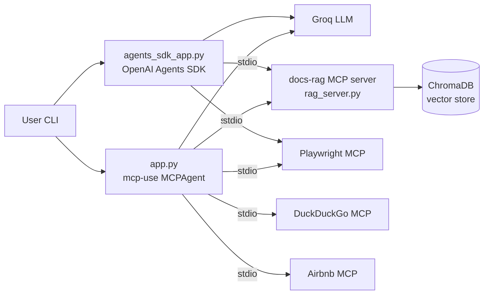

# MCP Browser Agent + RAG MCP Server

Tool-calling LLM agents that use **Model Context Protocol (MCP)** servers as their tools: browser automation, web search, and a **RAG server I built** that searches your own documents.

Two agent versions are included:

| App | Framework | MCP servers it uses | Memory |
| --- | --- | --- | --- |
| `app.py` | mcp-use + LangChain (Groq) | docs-rag, Playwright, DuckDuckGo, Airbnb | Built-in conversation memory |
| `agents_sdk_app.py` | OpenAI Agents SDK (Groq via OpenAI-compatible API) | docs-rag, Playwright | SQLite session |

Both run on **Groq's free tier** (`openai/gpt-oss-120b`), so no paid API key is needed.

## Architecture



## The RAG MCP server (`rag_server.py`)

Built with FastMCP (official MCP Python SDK). It exposes three tools:

| Tool | What it does |
| --- | --- |
| `ingest_folder(folder)` | Loads `.txt`, `.md` and `.pdf` files, splits them into overlapping chunks (800 chars, 120 overlap, sentence-aware), embeds them and stores them in ChromaDB |
| `search_docs(query, k)` | Semantic search; returns the top-k chunks with source file and cosine-similarity score |
| `list_sources()` | Lists ingested files and their chunk counts |

Embeddings use ChromaDB's default local model (all-MiniLM-L6-v2, downloaded once, free). Re-ingesting a file does not create duplicates.

It runs over **stdio** (for agents and Claude Desktop) or **SSE**: `uv run rag_server.py --sse`.

## Setup

Requirements: [uv](https://docs.astral.sh/uv/), Node.js (for the Playwright and Airbnb servers), a free [Groq API key](https://console.groq.com/keys).

```bash
uv sync
copy .env.example .env      # Windows (use cp on macOS/Linux), then add your keys
npx playwright install chromium
```

## Run

```bash
# mcp-use agent (all four MCP servers)
uv run app.py

# OpenAI Agents SDK agent (RAG + browser)
uv run agents_sdk_app.py
```

Example session:

```
You: Ingest the folder sample_docs
You: How many days of annual leave do employees get?
Assistant: 24 days of paid annual leave per year; up to 5 unused days carry over [company_handbook.md].
You: Open python.org and tell me the latest Python release
```

## Tracing with LangSmith

Set `LANGSMITH_TRACING=true`, `LANGSMITH_API_KEY` and `LANGSMITH_PROJECT` in `.env`. Every LLM call and tool call made by `app.py` then appears as a trace in LangSmith (free developer plan).

## Tests

```bash
uv run pytest
```

Tests cover chunking and the ChromaDB store (ingest, search, de-duplication) and run offline with a stub embedding function.

## Use the RAG server in Claude Desktop

Add this to `claude_desktop_config.json`, then restart Claude Desktop:

```json
{
  "mcpServers": {
    "docs-rag": {
      "command": "uv",
      "args": ["--directory", "C:\\path\\to\\mcp-browser-agent", "run", "rag_server.py"]
    }
  }
}
```

## Project structure

```
app.py               mcp-use agent with memory (LangChain + Groq)
agents_sdk_app.py    OpenAI Agents SDK agent using MCP servers
rag_server.py        RAG MCP server (ingest, search, list sources)
rag/chunking.py      file loading (txt, md, pdf) and chunking
rag/store.py         ChromaDB document store
browser_mcp.json     MCP server config for app.py
sample_docs/         example documents to try ingestion
tests/               pytest unit tests
```
